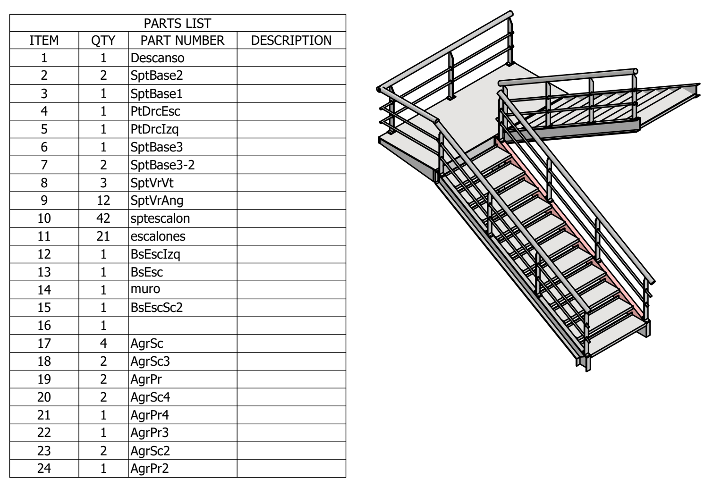
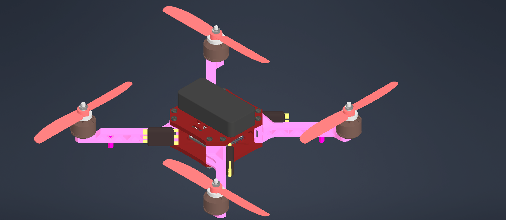

# CAD Portfolio

Four CAD projects in Autodesk Inventor and SOLIDWORKS, covering assembly modeling and technical documentation.

| Project | Software | What to look for |
| --- | --- | --- |
| [Staircase assembly](projects/staircase/README.md) | Autodesk Inventor | Assembly drawing and 24-line parts list |
| [Articulated arm](projects/articulated-arm/README.md) | Autodesk Inventor | Linkages, gears, and gripper |
| [Engine assembly](projects/engine/README.md) | SOLIDWORKS | Crankshaft and piston inside the assembly |
| [Drone V1](projects/drone-v1/README.md) | Autodesk Inventor | Isometric and exploded views |

Editable CAD files are not included.
