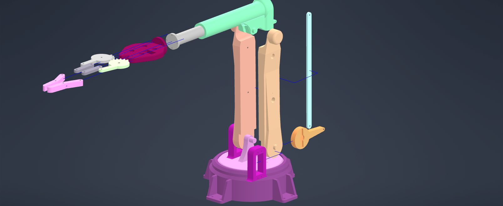

# Articulated Arm

**Autodesk Inventor · Mechanical assembly**

The assembly contains a base, articulated links, gears, a wrist, and a gripper. The source project also includes STL exports, including one named for the assembly. The exports do not establish that the arm was printed or tested.

## Isometric View

## Exploded View

**My contribution:** I modeled the components and built the assembly in Autodesk Inventor.
