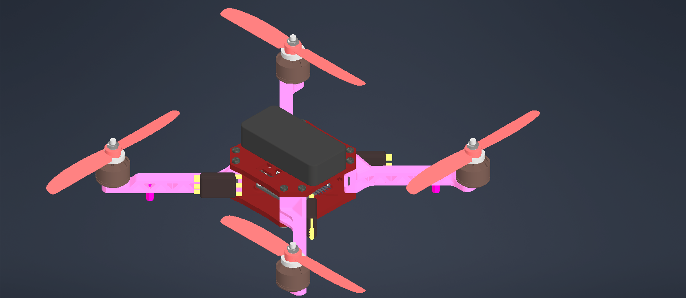
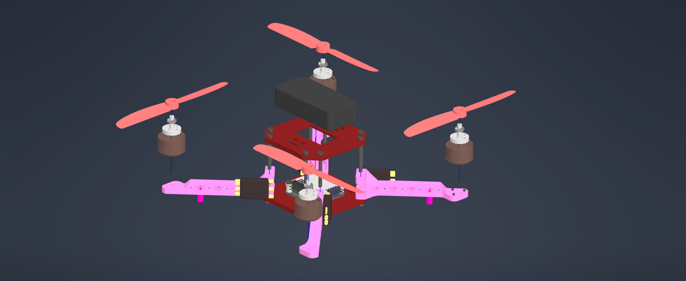

# Drone V1

**Autodesk Inventor · Assembly and subassembly**

The source project includes a main drone assembly, a separate connection assembly, and component models including a support and electrical units.

## Isometric View

## Exploded View

**My contribution:** I modeled the components and built the assembly and subassembly in Autodesk Inventor.
