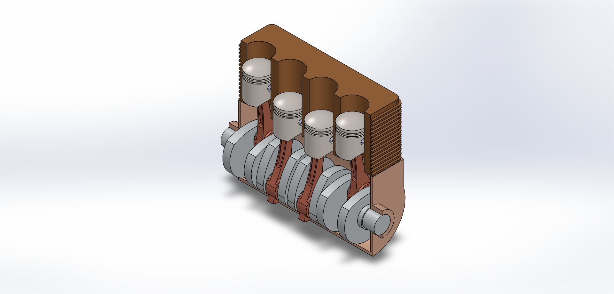
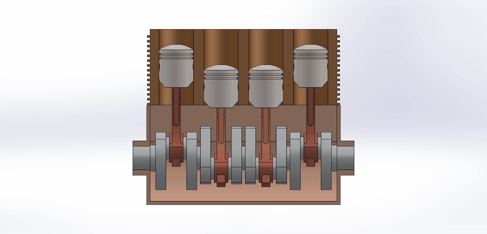

# Engine Assembly

**SOLIDWORKS · Mechanical assembly**

The source files include an engine assembly and separate models for the crankshaft, piston, pin, and lower block.

## Isometric View

## Internal Detail

**My contribution:** I modeled the components and built the assembly in SOLIDWORKS.
