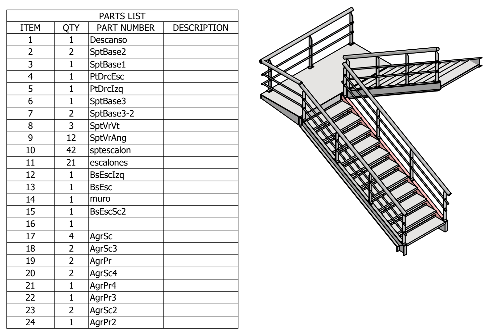
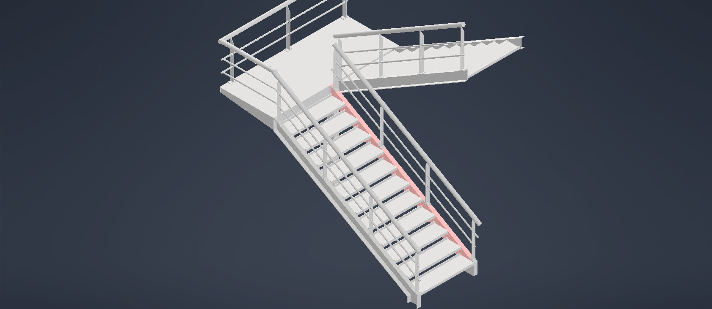

# Staircase Assembly

**Autodesk Inventor · Assembly modeling and technical drawings**

An academic project documenting a two-flight staircase with an intermediate landing. The assembly includes treads, supports, and railings. The drawing pairs an isometric assembly view with a 24-line parts list and quantities.

## My Contribution

I carried out the project from start to finish: I took measurements on site, sketched the layout, performed the structural calculations, and modeled the assembly in Autodesk Inventor. I also prepared the numbered assembly drawing and parts list.

## Assembly Drawing and Parts List

## Isometric View

